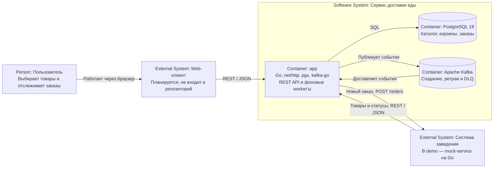
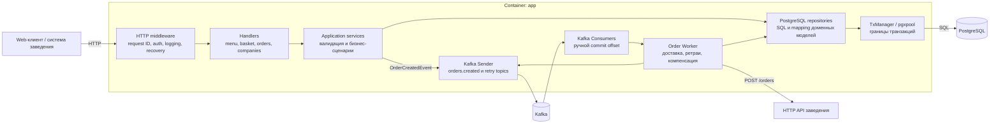
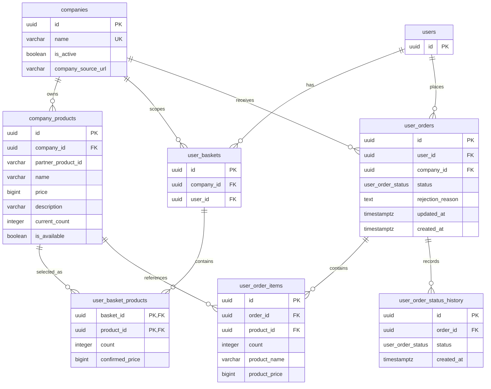

# Сервис доставки еды

MVP backend-сервиса заказа еды из ресторанов, кафе и магазинов. Сервис предоставляет единый HTTP API для двух сторон:

- пользовательский web-клиент получает список заведений и меню, управляет корзиной, оформляет заказ и отслеживает его статус;
- информационная система заведения публикует и обновляет товары, получает новые заказы и меняет их статусы.

В запросах, требующих авторизации, заголовок `Authorization` содержит UUID пользователя или заведения, так как по заданию авторизация не треубется.
Для демонстрации интеграции вместе с основным приложением запускается `mock-service`: он имитирует систему заведения, периодически отвечает ошибкой и тем самым позволяет проверить повторную доставку заказов.

## Возможности

- просмотр заведений, меню и карточки товара;
- отдельная корзина пользователя для каждого заведения;
- проверка доступности, остатка и изменения цены перед оформлением;
- атомарное списание остатков, создание заказа, фиксация состава заказа и очистка корзины;
- управление меню и статусами заказов со стороны заведения;
- асинхронная отправка заказа заведению через Kafka;
- повторные попытки через 1, 5 и 15 секунд, DLQ, отклонение заказа и возврат остатков после исчерпания попыток;
- OpenAPI/Swagger, SQL-миграции, структурированные логи, unit-тесты и code-generated CJM-диаграммы.

Цены хранятся целыми числами в копейках: например, `49900` соответствует `499,00`

## Быстрый запуск

Понадобятся Docker и Docker Compose и cкопировать пример конфигурации
```bash
make env-up
```

Docker Compose поднимет PostgreSQL, применит миграции и demo seed, запустит Kafka, основной сервис и демонстрационное заведение. После прохождения healthcheck доступны:

| Адрес                                      | Назначение                      |
|--------------------------------------------|---------------------------------|
| `http://localhost:8080/api/v1`             | REST API                        |
| `http://localhost:8080/swagger/index.html` | Swagger UI                      |
| `localhost:5432`                           | PostgreSQL                      |
| `localhost:9092`                           | Kafka                           |
| `http://localhost:8081`                    | API демонстрационного заведения |

Остановить окружение:

```bash
make env-down
```

Seed создаёт тестовые данные:

| Сущность          | UUID                                   |
|-------------------|----------------------------------------|
| Demo company      | `11111111-1111-4111-8111-111111111111` |
| Demo user         | `22222222-2222-4222-8222-222222222222` |

Полный контракт запросов и ответов находится в [Swagger UI](http://localhost:8080/swagger/index.html) и в файле [docs/swagger.yaml](docs/swagger.yaml).

## API

Все прикладные маршруты имеют префикс `/api/v1`.

| Доступ       | Метод и путь                                             | Назначение                                 |
|--------------|----------------------------------------------------------|--------------------------------------------|
| Публичный    | `GET /companies`                                         | Список заведений                           |
| Публичный    | `GET /companies/{companyId}/products`                    | Меню заведения                             |
| Публичный    | `GET /products/{productId}`                              | Карточка товара                            |
| Пользователь | `GET /companies/{companyId}/basket`                      | Текущая корзина                            |
| Пользователь | `PUT /companies/{companyId}/basket/items/{productId}`    | Добавить товар или заменить его количество |
| Пользователь | `DELETE /companies/{companyId}/basket/items/{productId}` | Удалить товар                              |
| Пользователь | `PATCH /companies/{companyId}/basket/price-confirmation` | Подтвердить актуальные цены                |
| Пользователь | `POST /companies/{companyId}/orders`                     | Создать заказ из корзины                   |
| Пользователь | `GET /orders/my`                                         | История заказов пользователя               |
| Пользователь | `GET /orders/{orderId}`                                  | Заказ пользователя                         |
| Заведение    | `POST /company/products`                                 | Создать товар                              |
| Заведение    | `PATCH /company/products/{partnerProductId}`             | Обновить товар по ID в системе заведения   |
| Заведение    | `PATCH /company/orders/{orderId}/status`                 | Изменить статус заказа                     |

Для маршрутов пользователя в `Authorization` передаётся UUID пользователя, для маршрутов заведения — UUID заведения. Middleware проверяет формат идентификатора, а сервисный слой — наличие сущности и право доступа.

Статус заказа принимает одно из значений: `created`, `rejected`, `accepted`, `preparing`, `completed`. Повторная установка текущего статуса идемпотентна; отклонённый заказ больше не изменяется.
`created`   - для только что созданного заказа и ещё не принятого заведением
`accepted`  - заказ, принятый заведением
`preparing` - готовящийся заказ
`completed` - приготовленный заказ
`rejected`  - заказ, отклонённый заведением
## Архитектура

Проект реализован как модульный монолит. Это сокращает операционные расходы MVP, а границы пакетов оставляют возможность вынести обработку заказов или каталог в отдельные сервисы. HTTP API и фоновые consumer'ы работают в одном процессе `app`, но используют разные входные адаптеры.

### C4 Level 2 — контейнеры



`mock-service` разворачивается тем же Docker Compose, но находится за границей сервиса доставки еды: он представляет внешний контур конкретного заведения. На вход он принимает заказ с `order_id` и позициями в терминах `partner_product_id`, а при успешной обработке вызывает API смены статуса основного сервиса.

### C4 Level 3 — компоненты `app`



Зависимости направлены внутрь: transport и handlers преобразуют внешние данные, services реализуют сценарии над доменными типами, repositories инкапсулируют PostgreSQL. Интерфейсы между слоями объявлены на стороне потребителя, благодаря чему сервисы тестируются с mock-реализациями.

Основные каталоги:

| Путь                           | Ответственность                                                        |
|--------------------------------|------------------------------------------------------------------------|
| `cmd/app`                      | Composition root основного приложения                                  |
| `cmd/mock-service`             | Демонстрационная система заведения                                     |
| `internal/core`                | Доменные типы, ошибки, конфигурация, HTTP-инфраструктура и логирование |
| `internal/handlers`            | HTTP-маршруты и DTO                                                    |
| `internal/service`             | Прикладные сценарии корзины, меню, заказов и worker'а                  |
| `internal/repository/postgres` | Репозитории, SQL и управление транзакциями                             |
| `internal/transport`           | Kafka и HTTP-модели интеграций                                         |
| `migrations`                   | Версионируемая схема и demo seed                                       |
| `docs`                         | Сгенерированная OpenAPI-спецификация                                   |
| `diagrams/CJM`                 | Пользовательские сценарии в PlantUML                                   |

### Оформление и доставка заказа

1. Пользователь кладёт товары одного заведения в корзину. В строке корзины сохраняется цена, которую видел пользователь.
2. При оформлении сервис в транзакции обновляет подтверждённые цены, сверяет состав и цены запроса с корзиной и проверяет остатки.
3. В той же транзакции сервис уменьшает остатки, создаёт заказ со статусом `created`, сохраняет снимки позиций, записывает историю статуса, очищает корзину и публикует `OrderCreatedEvent`.
4. Worker читает событие и отправляет заказ на `company_source_url`. Заведение получает собственные `partner_product_id`, поэтому ему не нужно знать внутренние UUID каталога.
5. Ответ `2xx` завершает доставку. Сетевая ошибка или `5xx` переводит событие по цепочке `orders.retry.1s` → `orders.retry.5s` → `orders.retry.15s` → `orders.dlq`; прочий ответ сразу отправляет его в DLQ.
6. Consumer DLQ транзакционно переводит ещё не принятый заказ в `rejected`, фиксирует причину и возвращает товары на склад.

Kafka offset подтверждается вручную после успешной обработки или переноса события в следующий topic. Поэтому доставка имеет семантику at-least-once, а API заведения должен идемпотентно обрабатывать повторный `order_id`.

## Схема базы данных

PostgreSQL используется в качестве базы данных. Актуальная DDL находится в [migrations/000001_init.up.sql](migrations/000001_init.up.sql), демонстрационные данные — в [migrations/000002_seed_demo.up.sql](migrations/000002_seed_demo.up.sql).



### Назначение таблиц и ограничения

| Таблица                     | Назначение и ключевые ограничения                                                                                  |
|-----------------------------|--------------------------------------------------------------------------------------------------------------------|
| `companies`                 | Заведения и URL их интеграционного API; имя уникально                                                              |
| `company_products`          | Актуальный каталог и остатки; `price > 0`, `current_count >= 0`, пара `(company_id, partner_product_id)` уникальна |
| `users`                     | Минимальная пользовательская сущность без профиля и credentials, поскольку auth не входит в MVP                    |
| `user_baskets`              | Корзина конкретного пользователя в конкретном заведении; `(company_id, user_id)` уникальна                         |
| `user_basket_products`      | Состав корзины; составной PK `(basket_id, product_id)`, положительное количество и последняя подтверждённая цена   |
| `user_orders`               | Заголовок заказа, текущий статус, причина отказа и timestamps                                                      |
| `user_order_items`          | Неизменяемый снимок товара на момент заказа: сохраняет имя, цену и количество независимо от будущих правок меню    |
| `user_order_status_history` | Первое появление каждого статуса в заказе; `(order_id, status)` уникальна                                          |

Внешние ключи используют стандартное поведение PostgreSQL `NO ACTION`: связанные сущности нельзя удалить, пока на них есть ссылки. Физическое удаление меню в API не предусмотрено — товар можно скрыть через `is_available`.

Для основных запросов созданы индексы:

- `idx_products_company` — меню заведения;
- `idx_orders_user_created` — история заказов пользователя от новых к старым;
- `idx_orders_company_status` — выборка заказов заведения по статусу;
- `idx_status_history_order` — хронология статусов заказа.

### Решения модели данных

- Внутренний `company_products.id` отделён от `partner_product_id`. Интеграция использует идентификатор заведения, что упрощает внедрение заведений со своими идентификаторами, а связи внутри сервиса доставки еды остаются стабильными.
- Корзина привязана к паре пользователь–заведение, поэтому один заказ не смешивает товары разных заведений.
- `confirmed_price` позволяет обнаружить изменение цены между добавлением товара и оплатой.
- `user_order_items` хранит снимок имени и цены: история заказа не меняется после редактирования каталога, позволяет юзеру увидеть всю историю заказов
- Остатки уменьшаются SQL-операцией внутри транзакции. Ограничение `current_count >= 0` защищает от продажи сверх доступного количества при конкурентных запросах.
- Текущий статус хранится в `user_orders` для быстрых чтений, а отдельная таблица фиксирует историю.

## CJM

PlantUML-диаграммы находятся в каталоге [diagrams/CJM](diagrams/CJM): там описаны поиск товара, управление корзиной, успешное оформление, конфликт при checkout, просмотр статуса, публикация меню, принятие заказа и обновление статуса заведением.

## Проверка качества

- Имеются unit-тесты, а также e2e тесты, проверяющие полный flow оформления заказа пользователем
- Для корректной работы e2e тестов следует заранее установить 2 докер образа(confluentinc/confluent-local:7.5.0,postgres:16-alpine)
Запуск тестов:

```bash
make tests
```

Запуск настроенных статических проверок и форматтеров:

```bash
golangci-lint run
```

Конфигурация линтера находится в [.golangci.yml](.golangci.yml).

## Границы MVP и развитие

- Простая передача UUID в `Authorization`. Для реального запуска нужны identity provider, подписанные токены и роли, а также проверка в middleware
- Отсутствие разделения partitions в брокере сообщений, для масштабирования стоит увеличить количество consumers
- Нет упрощённого поиска товаров по категориям для юзера, следует добавить это в дальнейшем развитии
- Отсутствие какого-либо списания средств со счёта юзера, но имеется полная цена, которая сохраняется в бд, её стоит использовать для списаний
- В MVP нет пагинации, rate limiting, распределённой трассировки и метрик. Эти механизмы нужно добавить до масштабирования публичного API.
